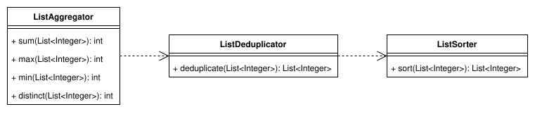
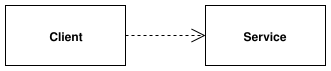
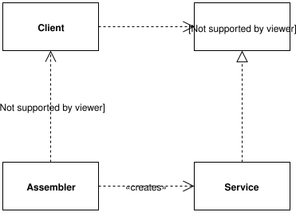

# [Software Design and Testing Laboratory](https://sigarra.up.pt/feup/pt/ucurr_geral.ficha_uc_view?pv_ocorrencia_id=586992)


## Lab-04/05/06: Unit Testing with JUnit 

Each lab should be submitted at the GitLab repository (hosted on the University of Porto GitLab instance, `gitlab.up.pt`) that has already been created for you: `unit-testing-junit-spock-lab3-<up id>`. This is where the final version of the lab must be submitted. Submitted labs will be evaluated as part of the class participation component.


### 1. Access your GitLab repository

- Your repository has **already been created**: `unit-testing-junit-spock-lab3-<up id>` (where `<up id>` is your institutional identifier, e.g. `up201406150`). You should have received an **email invitation** to accept access to it.
- Accept the invitation and open your repository, for example:
`https://gitlab.up.pt/ldts/ldts2627/unit-testing-junit-spock-lab3-<up id>`. Leave it open, you will need it later.
- This repository is where the **final version of the lab must be submitted**.


### 2. Project Setup

- **Download** and **unzip** the following [project](https://moodle2627.up.pt/mod/resource/view.php?id=65480) into a suitable folder on your computer.
- Launch **IntelliJ**, then **open** the project.
- To Run all tests, navigate to `src/test/java`, **right-click** and choose **“Run Tests in 'numbers.test'”**.
- Ensure that all tests **pass**. If necessary, enable the display of passing tests by clicking the checkmark (✔️) icon.
- Initialize a Git repository by running `git init` in the terminal. 
- Be sure to exclude unnecessary files (like `.idea/`) from version control. If there is no `.gitignore` file at the root of the project, create one.
    ```
    .idea/
    .gradle/
    out/
    build/
    *.iml
    ```
- Connect your local repository to the remote by running `git remote add origin <remote_address>`. The remote address is the **SSH** address of your GitLab repository and should resemble: `git@gitlab.up.pt:ldts/ldts2627/unit-testing-junit-spock-lab3-<up id>.git`. (Refer to the steps from our last lab if needed). After linking, don't forget to commit your changes and push them to the remote repository.

> :heavy_exclamation_mark: Pushing to `gitlab.up.pt` requires you to be on the **FEUP network** (for example, **eduroam** on campus). If you are working **outside the FEUP network**, connect through the **FEUP VPN** first. If you cannot configure the VPN, **change your remote to HTTPS** instead of SSH (HTTPS is reachable from outside the FEUP network) by running:
>
> ```shell
> git remote set-url origin https://gitlab.up.pt/ldts/ldts2627/unit-testing-junit-spock-lab3-<up id>.git
> ```

### 3. Inspect and Analyze the Project

The project includes three key classes:

- `ListAggregator`: Provides methods to perform various calculations on lists of integers, such as computing the **sum**, **minimum**, **maximum**, and **distinct** values. The `distinct()` method returns the count of unique numbers in the list.
- `ListDeduplicator`: Removes duplicate entries from a list of integers.
- `ListSorter`: Sorts a list of integers in order.



The `distinct` method in the `ListAggregator` class **relies** on the `ListDeduplicator` class to calculate the number of unique elements in a list.

Additionally, the `ListDeduplicator` class **depends** on the `ListSorter` class, as removing duplicates is more efficient when the list is already sorted. [[Why is this important? Remember the concept of Test Isolation#Slide 20](https://web.fe.up.pt/~arestivo/slides/?s=unit-testing#20)]

### 4. Simplify Test Setup

Take a moment to observe that our test methods are **structured** around **three distinct phases** (the 3 As):

- **Arrange**: This phase involves setting up the test and organizing the necessary data.
- **Act**: The method being tested is invoked.
- **Assert**: A single logical assertion is made to verify the outcome.

You’ll notice that the setup for the `ListAggregator` tests remains consistent throughout.

```java
List<Integer> list = Arrays.asList(1,2,4,2,5);
```

##### 4.1 Do **one of two** things

- Create a **helper method** that can be **called** from **each test** to return the list to be tested. This approach is preferable if you are using different values in each test.
```java
public class ListAggregatorTest {

    // Helper method to return a list for testing
    private List<Integer> getTestList() {
        return ...;
    }

    @Test
    public void testSum() {
        List<Integer> numbers = getTestList();
        ...
    }
}
```
- Implement a **helper** method with a `@BeforeEach` **annotation** that sets up the list as an attribute. Methods annotated with `@BeforeEach` are executed before **each test**. Not sure how `@BeforeEach` works? [Unit Testing Class#Slide 18](https://web.fe.up.pt/~arestivo/slides/?s=unit-testing#18).
```java
public class ListAggregatorTest {

    private List<Integer> numbers;

    // Set up the list before each test
    @BeforeEach
    public void setUp() {
        numbers = ...
    }

    @Test
    public void testSum() {
        int sum = ListAggregator.sum(numbers);
        assertEquals(15, sum);
    }
}
```

**Summary:**
- In **Option 1**, the helper method is called directly in each test to provide the necessary list.
- In **Option 2**, the `@BeforeEach` annotation initializes the list before each test, making it accessible as an instance variable.

##### 4.2 Other Test Classes

Apply the same approach to **the other test classes**, ensuring that all tests **continue to pass**. To do this, navigate to `src/test/java`, right-click, and select the `Run 'Tests in 'numbers.test''` option.

##### 4.3 Try Making a Test to Fail


Next, open the `ListSorterTest` class and modify the line `list = Arrays.asList(3, 2, 6, 1, 4, 5, 7);` to `list = Arrays.asList(3, 2, 6, 1, 4, 5, 6);`. Note that this change will cause list to differ from the expected list, resulting in one of the tests failing. ❌

After that, revert the changes and run the tests again. All tests should pass successfully. ✅

### 5. Corner Cases

You received a **bug report**!

```
Bug report #7263

I am encountering an incorrect maximum
result for the following list of
numbers: -1, -4, and -5. The max
function returns 0 instead of -1. There
seems to be an issue!
```

Let’s write a test case in `ListAggregatorTest.java` to address this bug report:

- Create a test method named `max_bug_7263` that confirms the bug. 
- Ensure that the `assertEquals` statement reflects the intended program behavior, meaning the expected maximum value should be `-1`.
- Run the test and observe that it **fails** ❌.
- **Fix** the **code** to **ensure** that the test passes ✅.


### 6. Distinct

You received a new **bug report**!

```
Bug report #8726

I am receiving an incorrect count of
distinct values for the following list 
of numbers: 1, 2, 4, and 2. The distinct 
function returns 4 instead of the 
expected 3. There seems to be an issue!
```
##### 6.1 Create the test

Let's write the test case for the bug report on `ListAggregatorTest.java`.

- Start by creating a **test** that **confirms** the **bug**. Call it `distinct_bug_8726`.
- Ensure that the `assertEquals` statement reflects the intended program behavior, meaning the expected number of distinct values should be `3`.
- Run the test and observe that it **fails** ❌.

##### 6.2 Inspect the issue

Let's now look into the problem. 🔍 Open 
the `ListAggregator.distinct()` code. 

> :heavy_exclamation_mark: **Spoiler alert**: you won’t find anything wrong…

The **issue** is that when we test the `distinct()` method, we are indirectly testing its dependency, the `ListDeduplicator.deduplicate()` method. To ensure accurate testing, we need to isolate these components and test them independently, following the principles of **test isolation**.

##### 6.3 How could we fix the test?


To test the `distinct()` and the `deduplicate()` methods **independently** from each other, we must go from a design that looks like this:




To something like this:



Where the **client** (`ListAggregator`) should depend on an **interface** (let's name it `GenericListDeduplicator`), rather than a concrete implementation.

```java
public interface GenericListDeduplicator {
    // ...
}
```

```java
public class ListDeduplicator implements GenericListDeduplicator {
    // ...
}
```

An `Assembler` class (in this case, `ListAggregatorTest`) will be responsible for creating the concrete implementation of the **service** (such as `ListDeduplicator`) and injecting it into the **client** (`ListAggregator`). 

```java
ListDeduplicator dedup = new ListDeduplicator();
int distinct = aggregator.distinct(Arrays.asList(1, 2, 4, 2), dedup);
```
This approach promotes flexibility and decouples the components, allowing for easier testing and future modifications.

This technique is known as **[Dependency Injection](https://web.fe.up.pt/~arestivo/slides/?s=unit-testing#21)**. It allows our test to inject into the `ListAggregator` any list deduplicator **service**, including one that always returns a predefined response (as explained in **Stub**, [Unit Testing Class#Slide 23](https://web.fe.up.pt/~arestivo/slides/?s=unit-testing#23)).


> :question: We have just done dependency injection via a parameter of the `distinct` method. Another option would be to inject this dependency via the constructor of the class. What are the advantages and disadvnages of doing one over the other?

```java
package com.aor.numbers;

import java.util.List;

public class ListAggregator {
    
    private final GenericListDeduplicator deduplicator;
    
    // Injeção de dependência in the constructor
    public ListAggregator(GenericListDeduplicator deduplicator) {
        this.deduplicator = deduplicator;
    }
    
    public Integer sum(List<Integer> list) {
        int sum = 0;
        for (Integer number : list)
            sum += number;
        return sum;
    }
    
    public Integer max(List<Integer> list) {
        int max = 0;
        for (Integer number : list)
            if (number > max)
                max = number;
        return max;
    }
    
    public Integer min(List<Integer> list) {
        int min = Integer.MAX_VALUE;
        for (Integer number : list)
            if (number < min)
                min = number;
        return min;
    }
    
    public int distinct(List<Integer> list) {
        List<Integer> distinctList = deduplicator.deduplicate(list);
        return distinctList.size();
    }
}
```


##### 6.4 Let's fix the test

To remove the dependency between the `ListAggregatorTest` and the `ListDeduplicator` class using a **stub**, we first need to:

- In the source code, create a `GenericListDeduplicator` interface that defines the `deduplicate()` method, which accepts a list of integers.
- Modify the `ListAggregator.distinct()` method to accept any class that implements the `GenericListDeduplicator` interface.
- Implement the `GenericListDeduplicator` interface in the `ListDeduplicator` class.
- Update the tests to inject a `ListDeduplicator` instance into the `distinct()` method for proper test execution.

And, then create the **Stub**:

- Create a **stub** that always returns the correct result for the data being tested. Implement it as an **inner-class** within the `ListAggregatorTest.distinct()` method. For example:
```java
    class Stub implements GenericListDeduplicator {
        @Override
        public List<Integer> deduplicate(List<Integer> list) {
            return valueToReturn; // Return the distinct elements
        }
    }
```
- Update both `distinct()` tests to inject a **stub** class. This ensures that both tests will **pass** consistently. ✅

This did **not fix** any bug; we merely **corrected** the failing test, as it wasn't the one that should have failed. To properly fix the issue in our code, we still need to:


- Create tests for `sort` and `deduplicate`, using the same values: `1, 2, 4 and 2`.
- Make sure to use **Dependency Injection** in the `ListDeduplicator()` method as it also depends on the `sort()` method.
- **Fix** the code that **needs fixing**. Only **one** of the tests should be failing now. Fix the bug in the function `sort()`. This function is not behaving properly.
> Hint: Look at the inner loop boundaries.

### 7. Mockito

Redo the previous exercise but this time use [Mockito](https://site.mockito.org/) to create the stubs.

To use **Mockito**, you must first add this to the dependencies on your **build.gradle** file:

```gradle
  testImplementation 'org.mockito:mockito-core:3.7.7'
```

Creating a deduplicator using Mockito, should look like this:

```java
GenericListDeduplicator deduplicator = Mockito.mock(GenericListDeduplicator.class);
```

Making the stub return the correct list can then be done like this:

```java
  Mockito.when(deduplicator.deduplicate(Mockito.anyList())).thenReturn(Arrays.asList(1, 2, 4));
```

Want to learn more? [Unit Testing#Slide 26](https://web.fe.up.pt/~arestivo/slides/?s=unit-testing#26)

### 8. COVERAGE

- Run all tests again, but this time **right-click** on `src/test/java`, and select **“Run All Tests with Coverage”**.

The report should appear on the right side of the screen.

Enter inside the **com** package, then inside the **aor** and **numbers** packages and verify if all classes, methods and lines are covered by your tests. If not add more tests until they are.

### 9. FILTERS

Create a new class `ListFilterer` that will be capable of **filtering** a **list of numbers**. This class should have a **constructor** that **receives a filter**:

```java
  public ListFilterer(GenericListFilter filter) { ... }
```

And single method called `filter` with the following **signature**:

```java
  public List<Integer> filter(List<Integer> list);
```

As you can see, this method **returns** a **list of numbers** that have been **filtered** by a certain **filter** (**Dependency Injection** again).

The `GenericListFilter` interface, should have only one method that returns true if a certain number should be accepted for that filter and false otherwise:

```java
  public boolean accept(Integer number);
```

Create **two classes** that follow this interface: `PositiveFilter` (that accepts only **positive** numbers) and `DivisibleByFilter` (that receives an **integer** upon construction and accepts only numbers **divisible** by that number).

- Create tests for all these classes (`ListFilterer`, `PositiveFilter` and `DivisibleByFilter`).
- Use **stubs** when necessary.
- Verify the test **coverage** again.

### 10. Mutation Testing

Test coverage allows us to **access** the **percentage** of lines **covered** by our **tests** but it does not verify the **quality** of those tests.

**Mutation** testing tries to **mitigate** this problem by creating **code mutations** (that should not pass the tests) and **verifying** if any of those mutations **survive** our test suite.

To use **PIT** (a **test mutation system** for **Java**) we must first add the following line to the **plugin section** of our **build.gradle** file:

```gradle
  id 'info.solidsoft.pitest' version '1.15.0'
```

Also add the following section anywhere in your **build.gradle** file:

```gradle
pitest {
  junit5PluginVersion = '1.0.0'
}
```

By default, **PIT** runs all tests **under** the **package** with the **same name** as the **group** defined in your **build.gradle** file. So if all your classes and tests are under the **com.aor.numbers** package, no other configuration should be necessary.

**PIT** should have **automatically** created a **gradle** **task** called **pitest** that you can execute by doing (or using the IntelliJ gradle panel):

```bash
./gradlew pitest
```

This will run **PIT** and create a **report** under `build/reports/pitest/<date>`. You can open this report using your **browser** and check if any mutations **survived**. You should see something like the following report:


Try **improving** your tests so **all mutations die**.

### 11. Hero Testing

- With your new found knowledge, create **tests** for the `Hero` code you created last class.
- Try using **Dependency Injection** to **remove** the **dependency** between your `Element` classes and the **lanterna** library.
- Try using **Mocks**, with **Mockito**, to test if the correct **lanterna** **functions** are being **called** by your code.
- Verify the **coverage** of your tests.
- Try **mutation** testing and **improve** the results by writing **more** and **better** tests.
